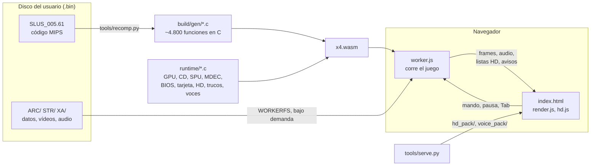

# Mega Man X4 en el navegador: cómo está hecho

Estado al 2026-10-22. Este documento sigue a [01-viabilidad.md](01-viabilidad.md) y cuenta todo lo
que se construyó después: la recompilación, el runtime, la versión web, el HD con IA, los trucos y
las voces en español.

---

## 1. Qué es

Un **port** de *Mega Man X4* (PlayStation, 1997, versión USA `SLUS_005.61`) que se juega en el
navegador desde el disco del propio usuario. No es un emulador: el ejecutable del juego se
**traduce entero a C** y se compila a **WebAssembly** (WASM), el formato que los navegadores
ejecutan casi a la velocidad de un programa nativo.

Lo que funciona hoy:

- El juego completo: intro, menús, niveles, vídeos, música y voces originales, partidas guardadas.
- Imagen panorámica 16:9, antialiasing y vídeos mejorados con Anime4K.
- **HD con IA a 8x**: los sprites y fondos se redibujan con versiones mejoradas por IA.
- **Trucos**: un modal con los códigos del juego y el modo **Completo** (tecla `Tab`).
- **Voces en español** en la primera conversación del juego (prueba de concepto).

> **Regla de oro:** el disco y todo lo que sale de él (archivos extraídos, código recompilado,
> `.wasm`, paquete HD, voces, partidas) se queda en el equipo del usuario. Nada de eso se sube ni
> se distribuye; está todo en `.gitignore`. La página pide al usuario su propia copia del disco,
> igual que los ports de DOOM piden el WAD.

---

## 2. Cómo jugar

```bash
make web                       # recompila (si hace falta) y genera web/x4.js + web/x4.wasm
python3 tools/serve.py 8765    # servidor local (también el HD y las voces)
```

Abrir `http://localhost:8765`, elegir `Mega Man X4 (USA).bin` y jugar. La página recuerda el disco
y la partida para la próxima vez.

| Tecla | Acción |
|---|---|
| `↑ ↓ ← →` | mover |
| `Z` | dash (◯) |
| `X` | saltar (✕) |
| `C` | disparo / espada (▢) |
| `V` | △ |
| `A` / `D` | L1 / R1 (cambiar arma) |
| `Q` / `E` | L2 / R2 |
| `Enter` | Start |
| `Shift` | Select |
| `Tab` | versión Completa (en la selección de personaje) |
| `P` / `Esc` | pausa |
| `⌘ + Enter` | pantalla completa |

También funciona con mando (Gamepad API, mapeo estándar).

Opciones de la URL para pruebas: `?sin-hd` (sin HD), `?probar-guardado` (abre el menú de guardar).

---

## 3. Arquitectura



Tres capas:

1. **Código del juego recompilado** (`build/gen/`, generado): cada función MIPS del ejecutable es
   una función C que trabaja sobre un estado de CPU emulado (registros, `hi/lo`, cop0, GTE) y la
   RAM de 2 MB.
2. **Runtime** (`runtime/`): todo lo que en la consola es hardware o BIOS, escrito en C.
3. **Plataforma**: nativa (`runtime/main.c`, para pruebas en la Mac) o web (`runtime/web.c` +
   `web/`).

### 3.1 Recompilador (`tools/recomp.py`)

- Lee el PS-X EXE y decide dónde empieza cada función: semillas de Ghidra
  (`data/functions_ghidra.json`), destinos de `jal` y punteros a código en los datos.
- Traduce cada instrucción literalmente a C. Los saltos dentro de una función son `goto`; las
  llamadas, funciones C; los saltos indirectos pasan por una tabla de despacho (`table.c`).
- Los bucles hacia atrás avanzan el reloj emulado (`CLOCK_TICK`), así el tiempo del juego avanza
  aunque el código espere en un bucle.
- `HLE`: funciones de las librerías de Sony sustituidas por versiones propias (por ejemplo `VSync`).
- `NOT_FUNCS`: falsos inicios de función que había que descartar (`0x8001cd40`, `0x8005cd40`; el
  segundo provocaba un cuelgue en el modo demo hacia el frame 29311).
- `PATCHES`: una instrucción concreta cambiada por otro C (panorámica, armas del modo Completo).
- `HOOKS`: una llamada al runtime al entrar en una función (panorámica, tarjeta, trucos).

### 3.2 Runtime (`runtime/`)

| Archivo | Qué emula |
|---|---|
| `runtime.c` | memoria, registros de hardware, BIOS en alto nivel, despacho, reloj (33,8688 MHz, 60 Hz) |
| `threads.c` | hilos de la BIOS sobre corrutinas nativas (pilas alineadas a 16 bytes) |
| `cdrom.c` | controlador de CD a nivel de registros; lee sectores del `.bin` a ritmo real (máx. 150 sectores/s) |
| `gpu.c` | GPU por software sobre una VRAM de 1024×512: sprites, polígonos, CLUT, transparencias; color de 24 bits y antialias de bordes |
| `mdec.c` | decodificador de vídeo (FMV `.STR`) |
| `audio.c` | audio XA (música y voces del CD): ADPCM y remuestreo a 44,1 kHz |
| `spu.c` | chip de sonido: 24 voces ADPCM con ADSR y la entrada de audio del CD |
| `memcard.c` | tarjeta de memoria (`bu00:`), formato `.mcr` estándar de 128 KB |
| `widescreen.c` | panorámica 16:9: el juego dibuja 426×240 en vez de 320×240 |
| `hd.c` | listas de dibujo y capturas para el HD con IA |
| `texdump.c` | herramienta: volcado de texturas (solo nativo) |
| `cheats.c` | modo Completo |
| `voice.c` | detección de la caja de diálogo en pantalla |

### 3.3 Versión web (`web/`)

- `worker.js` corre el juego en un Web Worker. El disco se monta con **WORKERFS**: se leen los
  sectores bajo demanda, sin copiarlo ni subirlo. El disco y la tarjeta se recuerdan en
  IndexedDB.
- `index.html` es la página: teclado y mandos, audio (AudioWorklet con corrección de deriva),
  ritmo exacto de 60 frames por segundo, pausa, pantalla completa, trucos y subtítulos.
- `render.js` presenta la imagen con WebGL2. El filtro de píxeles es *sharp-bilinear*, fijo; xBR,
  ScaleFX y CRT existen pero no se muestran como opción. Los vídeos usan Anime4K (`anime4k.js`).
- `hd.js` es el renderizador HD (sección 4).

### 3.4 Herramientas de prueba (versión nativa)

`./build/x4 extracted/SLUS_005.61 <frames> <disco.bin> <segundos>` corre el juego sin ventana. Con
variables de entorno:

| Variable | Para qué |
|---|---|
| `X4_INPUT="300:start,2080-2200:l1"` | pulsar botones en esos frames (guion de juego) |
| `X4_DUMP=dir`, `X4_DUMP_EVERY=n` | guardar la pantalla y la VRAM cada n frames |
| `X4_PEEK=dir1,dir2` | imprimir palabras de RAM cada `X4_PEEK_EVERY` frames |
| `X4_POKE="2000:801721f7=1"` | escribir un byte de RAM en un frame |
| `X4_RAMDUMP="4300:archivo"` | volcar los 2 MB de RAM en un frame |
| `X4_WIDE`, `X4_NOAA` | panorámica, sin antialias |
| `X4_CARD=archivo.mcr` | tarjeta de memoria |
| `X4_HDCAPTURE=dir`, `X4_HDLIST=dir:frames` | capturas y listas de dibujo HD |
| `X4_FULL` | modo Completo activado |
| `X4_VOICELOG` | imprimir la huella de cada caja de diálogo |
| `X4_WAV`, `X4_AUDIOSTAT`, `X4_BIOSLOG` | audio y registro de la BIOS |

En el navegador se prueba con Playwright (Chrome sin ventana): se carga el disco, se sigue un plan
de teclas por segundos y se guardan capturas.

---

## 4. HD con IA (8x)

**Objetivo:** que todo el juego (personajes, enemigos, fondos, menús, letreros) se vea en alta
definición, a 8 veces la resolución original.

**Por qué es difícil:** la PS1 dibuja con piezas de textura de 16×16 que el juego sube a la VRAM
sobre la marcha y colorea con paletas que cambian (destellos, daño). No hay "una imagen de X" que
cambiar: hay miles de trocitos que aparecen y desaparecen.

### Cómo funciona

1. **Registro** (`runtime/hd.c`). Cada primitiva que dibuja el juego se anota en una lista de
   dibujo por búfer de pantalla. Cada pieza se reconoce por una **huella de su contenido** (los
   índices de color), no por su posición en la VRAM. La VRAM se fotografía al mostrar el frame, y
   las paletas en el momento de dibujar.
2. **Redibujado** (`web/hd.js`). La página vuelve a dibujar el frame con la GPU a la resolución de
   la pantalla, con 4x MSAA. Cada pieza con versión HD se dibuja con ella; las demás, suavizadas.
   Las piezas HD guardan **índices de paleta**, no colores, así que los destellos del juego siguen
   funcionando. Atlas en la GPU: hasta 64 capas de 256 celdas de 128×128 (16.384 piezas), con
   descarte de las menos usadas.
3. **Captura de piezas nuevas.** Una pieza sin versión HD se captura **junto con su capa** (las
   piezas vecinas que se dibujan juntas), para que la IA vea el contexto y no queden costuras.
   La captura va al servidor (`hd_queue/`).
4. **Conversión** (`tools/hd/upscale.py`, en segundo plano mientras se juega):
   rellenar lo transparente con el color vecino → **4x-Fatal-Pixels** (IA, en la GPU de la Mac)
   → bicúbico hasta 8x → recortar cada pieza → limitar la silueta a la original (±4 px) →
   ajustar cada píxel a un índice de la paleta. Resultado: `hd_pack/<huella>.x4h`.

El paquete se precargó con la intro y 150.000 frames del modo demo, y crece mientras se juega
(unas 13.800 piezas hoy). Lo que falta se convierte la primera vez que aparece, en segundos.

### Problemas resueltos por el camino

| Síntoma | Causa | Solución |
|---|---|---|
| Piezas de X fuera de sitio | el juego cambia texturas antes de mostrar el frame | foto de la VRAM al mostrar y paletas al dibujar |
| Líneas entre piezas | cada pieza se mejoraba sola | captura por capas: una pasada de IA por capa |
| Columna suelta en sprites volteados | la PS1 lee el primer texel exacto y la GPU el centro del píxel | corregir u/v en +1 al voltear (`fix_flip`) |
| "Now Loading" y logos pixelados | piezas grandes sin escalar | partirlas en trozos de 16×16 |
| Cuadrícula en el fondo | piezas capturadas pegadas al borde de pantalla | esperar a que entren 16 px; interior opaco forzado |
| Manchas de otras piezas | la capa incluía piezas superpuestas | silueta propia más 4 px de margen |
| Tirones | carga de piezas durante el juego | precarga del paquete entero; memoria del wasm a 256 MB |

El parpadeo de la esfera de carga del disparo (un frame sí y otro no) es del juego original.

---

## 5. Trucos y modo Completo

El botón **Trucos** abre un modal (y pausa el juego) con:

- **Ultimate Armor** (código original): en la selección, sobre X: `Z Z`, `←` ×6, mantener `A`+`E`
  y pulsar `Enter`.
- **Zero Negro** (código original): sobre Zero: mantener `D`, `→` ×6, soltar `D`, mantener `Z` y
  pulsar `Enter`.
- **Versión Completa** (nuestra): en la selección, `Tab` sobre X o Zero. Sale un aviso dorado.
  - **X Completo:** Ultimate Armor, las 8 armas, vida al máximo (48), los 4 tanques llenos.
  - **Zero Completo:** Zero Negro, las 8 técnicas, vida al máximo, los 4 tanques llenos.
  - Los 8 jefes siguen por vencer, y se guarda con la partida.

### Ingeniería inversa del estado de la partida

Estado en `0x801721C0` (lo que se guarda en la tarjeta, empaquetado por `0x8001C07C`):

| Dirección | Contenido |
|---|---|
| `2203` | personaje (0 = X, 1 = Zero) |
| `2206` | vida máxima (32 + 2 por corazón) |
| `2207` | partes de armadura (bits; 0x0F = todas) |
| `2208` | tipo de disparo del brazo (2 = plasma) |
| `2219` | armas de jefes **= jefes vencidos** |
| `221A` | corazones (bits 0-7) y tanques (bits 12-15) |
| `221C`–`221E` | carga de los Sub Tanks y del Weapon Tank (máx. 32) |
| `21F7` | versión especial (Ultimate Armor / Zero Negro) |

Al empezar cada nivel, `0x80035240` copia ese estado al jugador (`0x801418C8`).

**La trampa:** en X4, tener el arma de un jefe y haberlo vencido es el mismo bit. Si se dan las 8
armas ahí, el juego cree que no quedan jefes. Por eso el modo Completo deja `2219` con los jefes de
verdad y pone una **marca propia** en un bit libre de `221A` (se guarda con la partida). Un
parche en `0x80035240` da las 8 armas al jugador al empezar cada nivel cuando está la marca.
Ojo: `0x8002FD70` también lee `2219`, pero para saber si el jefe del nivel ya está vencido; un
primer parche ahí dejaba a los jefes invencibles y se quitó.

**Otro detalle:** la versión especial decide qué gráficos carga el nivel, así que se pone mientras
se está en la selección (ganchos en `0x80029A48` y `0x80029BD8`, las rutinas que buscan los códigos)
y no al empezar el nivel.

**Eregion, el jefe de la introducción:** solo le hace daño la cabeza, y su tabla de daño
(`0x801066F0`, un par reacción/daño por tipo de ataque; la del cuerpo, `0x801060F0`, lo rebota
todo) rebota las armas de los jefes, los disparos del brazo de plasma y las técnicas de Zero: en el
juego original nadie los tiene todavía ahí. Con el modo Completo, mientras se está en ese nivel
(`21CC` = 0), los tipos que rebotaban hacen 3 de daño. Esa tabla solo la usa el código de Eregion.

---

## 6. Voces en español (prueba de concepto)

**Objetivo:** que los personajes hablen en español en vez de solo mostrar texto. La prueba cubre
**solo la primera conversación** tras elegir personaje (X: 6 cajas, Zero: 4).

### El texto del juego

- Está en `PL00_U.ARC` (partida con X, tabla de 54 mensajes en `0xBD000`) y `PL01_U.ARC` (Zero, 48
  mensajes en `0xB1000`). Hay unas 540 cajas y 3.500 palabras.
- 16 bits por carácter. Byte bajo: `A-Z` = c−9, `a-z` = c−3, dígitos desde `0x40`, `0xFF` espacio,
  `0x85` `,` `0x86` `.` `0x87` `!` `0x88` `?` `0x8B` `'`. Nibble alto: `5` salto de línea, `2` fin de
  caja (espera el botón), `A` fin de mensaje. La primera línea de la caja es el nombre de quien
  habla.
- En marcha, `0x8013BC28` apunta al carácter siguiente y `0x8013BC30` dice si la caja se abre
  (`0x1D`), se escribe (`0x2F`) o espera el botón (`0x41`).

### Cómo funciona

1. `runtime/voice.c` calcula la **huella** (FNV-1a) de la caja en pantalla y avisa a la página.
2. `voice_lines/poc.json` (local) tiene la traducción de cada caja y la voz de cada personaje.
3. `tools/voice/make_voices.py` genera los audios con **Piper** (IA de voz local) en
   `voice_pack/<huella>.wav`, más `index.json` con los subtítulos.
4. La página pone el audio, **tapa la caja en inglés con el subtítulo** (mismo estilo, coordenadas
   37–283 × 25–94 de la PS1) y **baja la música al 30%** mientras se habla.

Voces: Cuartel Hunter = `es_MX-claude-high` (mujer), X = `es_MX-ald-medium`, Zero =
`es_ES-davefx-medium` (más grave). Detalles en [tools/voice/README.md](../tools/voice/README.md).

---

## 7. Cronología

| Fecha | Hito |
|---|---|
| 2026-10-20 | Estudio de viabilidad: un solo ejecutable, sin overlays, poco GTE |
| 2026-10-21 | Recompilador y runtime: el juego arranca; versión web jugable con X y Zero |
| 2026-10-21 | Audio XA y SPU; ritmo exacto de 60 Hz; vídeos a velocidad real |
| 2026-10-21 | Tarjeta de memoria; panorámica 16:9, antialias, Anime4K |
| 2026-10-21 | HD con IA: comparación de modelos, integración a 8x |
| 2026-10-21 | Primer commit |
| 2026-10-22 | HD v2 por capas: sin costuras, sin tirones, sin cuadrícula |
| 2026-10-22 | Pantalla completa con `⌘ + Enter` |
| 2026-10-22 | Trucos: modal, códigos originales y modo Completo |
| 2026-10-22 | Voces en español: estudio y prueba de concepto |

---

## 8. Pendiente e ideas

- Comprobar en juego la selección de niveles y los poderes de la armadura con el modo Completo.
- Revisar "Zero se ve raro al respirar hacia arriba" (HD).
- Voces: doblar más conversaciones, probar voces más propias por personaje (XTTS), revisar
  otros archivos de texto de los niveles (`ST*_U*.ARC`).
- Reverberación de la SPU (no implementada).
- Exportar e importar la partida (`.mcr`), aplazado.

## 9. Créditos y licencias

- Referencia técnica del hardware: psx-spx.
- Direcciones de las rutinas de panorámica: análisis de MegaManX4Recomp (MIT); la implementación es
  propia.
- IA de imagen: 4x-Fatal-Pixels y otros modelos de OpenModelDB (CC-BY-NC), vía spandrel.
- IA de voz: Piper y las voces de `rhasspy/piper-voices` (cada una con su licencia).
- Shaders: Anime4K, xBR (Hyllian), ScaleFX (Sp00kyFox); ver `web/THIRD_PARTY.md`.
- *Mega Man X4* es de Capcom. Este proyecto no incluye nada del juego: cada usuario usa su disco.
